# Отчет по практической работе №3
|                |                                                                                                                     |
|----------------|---------------------------------------------------------------------------------------------------------------------|
| **Дисциплина** | Теория автоматов, языков и вычислений                                                                               |
| **Тема**       | Автоматы с магазинной памятью, контекстно-свободные грамматики и свойства контекстно-свободных языков в среде JFLAP |
| **Вариант**    | № 4                                                                                                                 |
| **Выполнил**   | Грушевский И. А. КИ24-16/1Б                                                                                         |
| **Проверил**   | Мымликов В. Н.                                                                                                      |

---

## 1. Цель работы

Исследование автоматов с магазинной памятью (МПА), контекстно-свободных грамматик (КСГ), приобретение практических навыков их проектирования и верификации в среде JFLAP, а также формальное доказательство принадлежности или непринадлежности языков к классу контекстно-свободных (КСЯ) с помощью леммы о разрастании.

---

## 2. Постановка задач

1. **Часть 1:** С использованием системы JFLAP построить МПА, распознающий язык $L_4 = \{a^n b^{m+n} c^m : n \ge 0, m \ge 1\}$. Указать критерий принятия цепочек, протестировать автомат и предоставить программную реализацию МПА.
2. **Часть 2:** С использованием системы JFLAP построить КСГ, описывающую язык $L_{20} = \{a^n b^m : 2n \le m \le 3n, m \ge 0, n \ge 0\}$. Протестировать грамматику с помощью Brute Force Parse.
3. **Часть 3:** Доказать формально контекстно-свободность либо ее отсутствие для языка
$$L_{36} = \{w \in \{a, b, c\}^* : n_a(w) / n_b(w) = n_c(w)\}$$

---

## 3. Структура файлов проекта

* `PDA.jff` — МПА для языка $L_4$ (Часть 1)
* `CFG.jff` — КСГ для языка $L_{20}$ (Часть 2)
* `pda_l4.py` — программная реализация МПА (бонус)
* `photo/` — скриншоты экспериментов и верификации в JFLAP

---

## 4. Часть 1. Автомат с магазинной памятью (МПА)

### 4.1. Логика работы автомата и критерий допуска

Цепочка языка $L_4$ имеет вид $a^n b^n \cdot b^m c^m$: сначала каждый символ $a$ гасится одним символом $b$, затем оставшиеся $m$ символов $b$ гасятся символами $c$.

* **Критерий принятия цепочек:** по заключительному (финальному) состоянию.
* **Принцип работы магазина:**
  * В $q_0$ на дно магазина кладется маркер $Z$ (в JFLAP магазин изначально пуст).
  * В $q_1$ каждый прочитанный символ $a$ добавляет в магазин маркер $A$.
  * По $\lambda$-переходу автомат переходит в $q_2$, где каждый символ $b$ снимает один маркер $A$.
  * Когда все $A$ сняты (на вершине $Z$), по $\lambda$-переходу автомат переходит в $q_3$, где последующие символы $b$ добавляют маркеры $B$.
  * В $q_3$ первый символ $c$ снимает $B$ и переводит автомат в $q_4$, где каждый следующий $c$ снимает по одному $B$.
  * Когда вход исчерпан и на вершине $Z$, автомат переходит в заключительное состояние $q_5$.
* Условие $m \ge 1$ выполняется автоматически: в $q_4$ можно попасть только по символу $c$, снимающему $B$, а $B$ появляется только после хотя бы одного $b$ в $q_3$.

### 4.2. Граф переходов МПА

$$P = (Q, \Sigma, \Gamma, \delta, q_0, Z_0, F)$$

где:
* $Q = \{q_0, q_1, q_2, q_3, q_4, q_5\}$;
* $\Sigma = \{a, b, c\}$;
* $\Gamma = \{A, B, Z\}$;
* $q_0$ — начальное состояние, $Z_0 = Z$;
* $F = \{q_5\}$.

Функция переходов $\delta$ (формат: читаем, вершина магазина; кладем):

* $\delta(q_0, \lambda, \lambda) = \{(q_1, Z)\}$
* $\delta(q_1, a, Z) = \{(q_1, AZ)\}$
* $\delta(q_1, a, A) = \{(q_1, AA)\}$
* $\delta(q_1, \lambda, \lambda) = \{(q_2, \lambda)\}$
* $\delta(q_2, b, A) = \{(q_2, \lambda)\}$
* $\delta(q_2, \lambda, Z) = \{(q_3, Z)\}$
* $\delta(q_3, b, Z) = \{(q_3, BZ)\}$
* $\delta(q_3, b, B) = \{(q_3, BB)\}$
* $\delta(q_3, c, B) = \{(q_4, \lambda)\}$
* $\delta(q_4, c, B) = \{(q_4, \lambda)\}$
* $\delta(q_4, \lambda, Z) = \{(q_5, \lambda)\}$

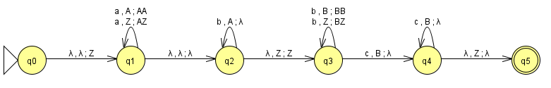

### 4.3. Пошаговое выполнение процесса распознавания (Step with State)

Трассировка на цепочке `abbc` (конфигурация: состояние, непрочитанный остаток, магазин, вершина слева):

| Шаг | Состояние | Остаток | Магазин |
|---|---|---|---|
| 0 | q0 | abbc | пуст |
| 1 | q1 | abbc | Z |
| 2 | q1 | bbc | AZ |
| 3 | q2 | bbc | AZ |
| 4 | q2 | bc | Z |
| 5 | q3 | bc | Z |
| 6 | q3 | c | BZ |
| 7 | q4 | λ | Z |
| 8 | q5 | λ | пуст |

Цепочка принята (финальное состояние $q_5$, вход прочитан).

Скриншоты пошагового выполнения в JFLAP:

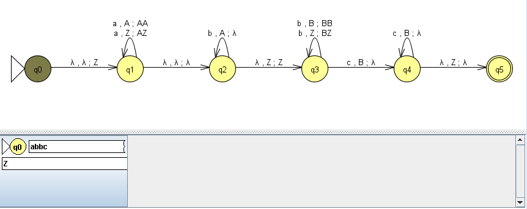
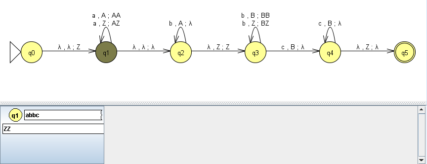
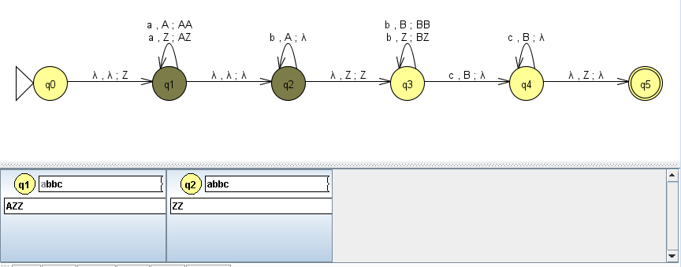
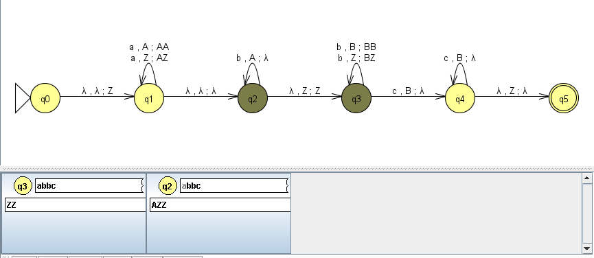
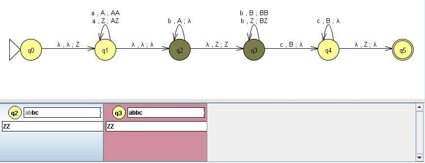
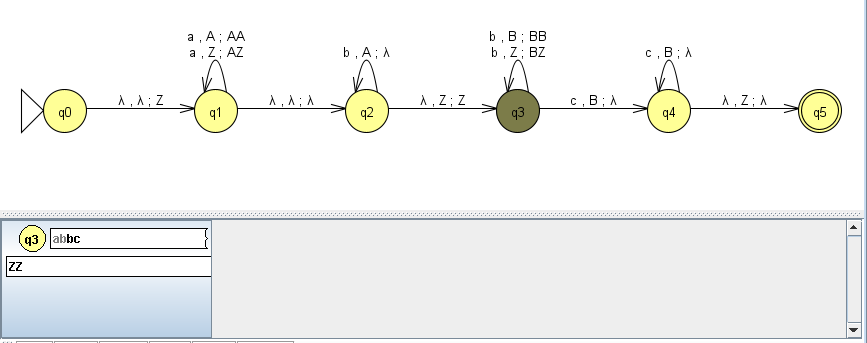
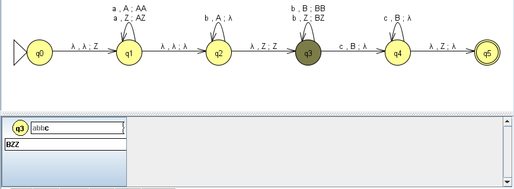
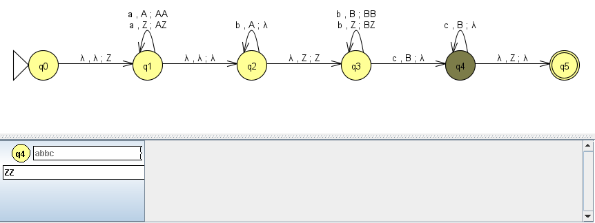
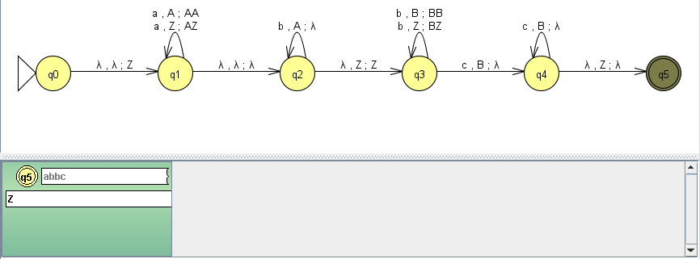

### 4.4. Верификация МПА (Multiple Run)

Тестирование в режиме **Input → Multiple Run**:

| Цепочка | Принадлежит $L_4$ | Результат |
|---|---|---|
| `λ` | нет ($m=0$) | отвергнута |
| `abc` | нет | отвергнута |
| `aabbc` | нет | отвергнута |
| `bcc` | нет | отвергнута |
| `abbcc` | нет | отвергнута |
| `bc` | да ($n=0, m=1$) | принята |
| `abbc` | да ($n=1, m=1$) | принята |
| `aabbbc` | да ($n=2, m=1$) | принята |
| `abbbcc` | да ($n=1, m=2$) | принята |

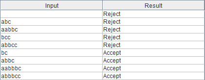

### 4.5. Программная реализация МПА

Реализация в файле `pda_l4.py` соответствует формальному определению из п. 4.2: недетерминированный МПА, поиск по всем достижимым конфигурациям (состояние, позиция во входе, магазин). **Критерий принятия — по финальному состоянию.**

Самотест программы сверяет ее ответы с определением языка на всех цепочках над $\{a,b,c\}$ длиной до 9; расхождений нет.

```python
DELTA = {
    ('q0', '',  ''):  [('q1', 'Z')],
    ('q1', 'a', 'Z'): [('q1', 'AZ')],
    ('q1', 'a', 'A'): [('q1', 'AA')],
    ('q1', '',  ''):  [('q2', '')],
    ('q2', 'b', 'A'): [('q2', '')],
    ('q2', '',  'Z'): [('q3', 'Z')],
    ('q3', 'b', 'Z'): [('q3', 'BZ')],
    ('q3', 'b', 'B'): [('q3', 'BB')],
    ('q3', 'c', 'B'): [('q4', '')],
    ('q4', 'c', 'B'): [('q4', '')],
    ('q4', '',  'Z'): [('q5', '')],
}
START, FINAL = 'q0', {'q5'}

def accepts(w):
    seen, todo = set(), [(START, 0, '')]
    while todo:
        q, i, st = todo.pop()
        if (q, i, st) in seen or len(st) > len(w) + 2:
            continue
        seen.add((q, i, st))
        if i == len(w) and q in FINAL:
            return True
        for (s, r, p), moves in DELTA.items():
            if s != q: continue
            if r and (i >= len(w) or w[i] != r): continue
            if p and not st.startswith(p): continue
            for q2, push in moves:
                todo.append((q2, i + len(r), push + st[len(p):]))
    return False
```

---

## 5. Часть 2. Контекстно-свободная грамматика (КСГ)

### 5.1. Анализ языка и схема правил

В языке $L_{20} = \{a^n b^m : 2n \le m \le 3n\}$ каждому символу $a$ соответствуют две или три буквы $b$. Поэтому достаточно порождать $a$ и сразу вместе с ним правую часть из двух или трех $b$.

Система правил:

* $S \to aSbb \mid aSbbb \mid \lambda$

**Обоснование.** Пусть первое правило применено $k$ раз, второе $j$ раз, затем $S \to \lambda$. Получается $a^{k+j} b^{2k+3j}$. При $n = k+j$ имеем $m = 2n + j$, где $0 \le j \le n$, то есть ровно $2n \le m \le 3n$. Любая пара $(n, m)$ с $2n \le m \le 3n$ достижима выбором $j = m - 2n$, $k = n - j$. Случай $n = 0$ дает пустую цепочку.

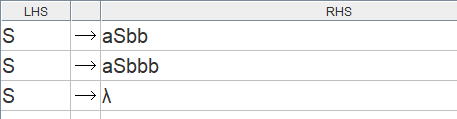

### 5.2. Тестирование КСГ (Multiple Brute Force Parse)

| Цепочка | Принадлежит $L_{20}$ | Результат |
|---|---|---|
| `abb` | да ($n=1, m=2$) | принята |
| `abbb` | да ($n=1, m=3$) | принята |
| `aabbbb` | да ($n=2, m=4$) | принята |
| `aabbbbb` | да ($n=2, m=5$) | принята |
| `aabbbbbb` | да ($n=2, m=6$) | принята |
| `ab` | нет ($m < 2n$) | отвергнута |
| `abbbb` | нет ($m > 3n$) | отвергнута |
| `aabbb` | нет ($m < 2n$) | отвергнута |
| `aabbbbbbb` | нет ($m > 3n$) | отвергнута |
| `b` | нет ($n = 0, m > 0$) | отвергнута |

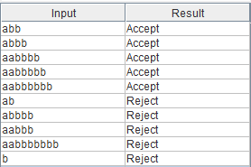

---

## 6. Часть 3. Исследование контекстно-свободности языка $L_{36}$

### 6.1. Формулировка задачи

$$L_{36} = \{w \in \{a, b, c\}^* : n_a(w) / n_b(w) = n_c(w)\}$$

Деление определено только при $n_b(w) \ge 1$, и равенство означает $n_a(w) = n_b(w) \cdot n_c(w)$. Цепочки с $n_b = 0$ в язык не входят. Требуется доказать, что $L_{36}$ не является КСЯ.

### 6.2. Доказательство

**Шаг 1. Сведение к более простому языку.** Класс КСЯ замкнут относительно пересечения с регулярным языком. Положим

$$M = L_{36} \cap a^+ b^+ c^+ = \{a^{jk} b^j c^k : j, k \ge 1\}.$$

Если бы $L_{36}$ был КСЯ, то и $M$ был бы КСЯ. Покажем, что $M$ не КСЯ.

**Шаг 2. Лемма о разрастании для $M$.** Допустим, $M$ — КСЯ, и $p$ — длина накачки. Возьмем $w = a^{p^2} b^p c^p \in M$ (здесь $j = k = p$). Согласно лемме, $w = uvxyz$, где $|vxy| \le p$, $|vy| \ge 1$ и $uv^i xy^i z \in M$ для всех $i \ge 0$.

Между блоками $a$ и $c$ стоит $p$ символов $b$. Поэтому $vxy$ не может содержать одновременно $a$ и $c$: для этого понадобилось бы $|vxy| \ge p + 2 > p$. Остаются три случая.

1. **$vy$ состоит только из $a$.** Пусть $|vy| = t$, $1 \le t \le p$. При $i = 0$ получаем $a^{p^2 - t} b^p c^p$. Так как $p^2 - t \ne p \cdot p$, цепочка не лежит в $M$.

2. **$vy$ содержит $b$ и не содержит $c$.** Пусть в $vy$ ровно $s$ символов $a$ и $r \ge 1$ символов $b$, причем $s + r \le p$, откуда $s \le p - 1 < rp$. При $i = 2$ получаем $a^{p^2 + s} b^{p + r} c^p$. Для принадлежности $M$ нужно $p^2 + s = (p + r)p = p^2 + rp$, то есть $s = rp$. Это неверно, цепочка не лежит в $M$.

3. **$vy$ содержит $c$ и не содержит $a$.** Пусть в $vy$ ровно $r \ge 0$ символов $b$ и $t \ge 1$ символов $c$. При $i = 2$ получаем $a^{p^2} b^{p + r} c^{p + t}$. Для принадлежности $M$ нужно $(p + r)(p + t) = p^2$, но $(p + r)(p + t) \ge p(p + 1) > p^2$. Цепочка не лежит в $M$.

Во всех случаях получено противоречие с леммой о разрастании, значит $M$ не является КСЯ.

**Вывод.** Поскольку $M = L_{36} \cap a^+b^+c^+$ не КСЯ, а КСЯ замкнуты относительно пересечения с регулярным языком, язык $L_{36}$ **не принадлежит классу контекстно-свободных языков**.

---

## 7. Заключение

В ходе работы исследованы принципы функционирования МПА и КСГ. В среде JFLAP построен МПА с допуском по финальному состоянию для языка $L_4 = \{a^n b^{m+n} c^m\}$ и реализована его программная версия на Python. Построена и верифицирована КСГ $S \to aSbb \mid aSbbb \mid \lambda$ для языка $L_{20}$. С помощью леммы о разрастании и замкнутости КСЯ относительно пересечения с регулярным языком доказано, что язык $L_{36}$ не является контекстно-свободным.