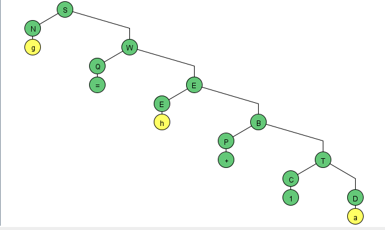

# Отчет по практической работе №4

|                |                                                                                                       |
|----------------|-------------------------------------------------------------------------------------------------------|
| **Дисциплина** | Теория автоматов, языков и вычислений                                                                 |
| **Тема**       | Универсальные алгоритмы синтаксического анализа контекстно-свободных языков: алгоритм Кока-Янгера-Касами |
| **Вариант**    | № 2                                                                                                   |
| **Выполнил**   | Грушевский И. А. КИ24-16/1Б                                                                           |
| **Проверил**   | Мымликов В. Н.                                                                                        |

---

## 1. Цель работы

Изучение универсальных алгоритмов синтаксического анализа контекстно-свободных языков, приобретение практических навыков построения контекстно-свободных грамматик (КСГ) и их приведения к нормальной форме Хомского (НФХ), а также анализ строк алгоритмом Кока-Янгера-Касами (CYK) в среде JFLAP.

---

## 2. Постановка задачи

С использованием системы JFLAP построить грамматику, определяющую язык оператора присваивания, в правой части которого задано логическое выражение, для анализа методом Кока-Янгера-Касами.

Элементы выражений:
* целочисленные константы в шестнадцатеричной системе счисления;
* имена переменных из одного символа (от `g` до `k`);
* знаки операций и скобки для изменения порядка вычисления подвыражений.

Операции (в сторону уменьшения приоритета): отрицание, мультипликативные, аддитивные, присваивание.

---

## 3. Структура файлов проекта

* `CFG_CNF.jff` — эквивалентная КСГ в НФХ для CYK-анализа (124 продукции);
* `images/` — скриншоты экспериментов и верификации в JFLAP.

---

## 4. Теоретические сведения

Алгоритм CYK является универсальным восходящим алгоритмом синтаксического анализа: он подходит для любой КСГ, заданной в НФХ, и затрачивает $O(n^3)$ шагов при памяти $O(n^2)$, где $n$ — длина входной строки.

Алгоритм строит треугольную таблицу $T$. В ячейку $t_{ij}$ помещается множество нетерминалов, из которых выводится подстрока длины $j$, начинающаяся с символа $a_i$:

$$t_{i1} = \{A \mid A \to a_i \in P\},$$
$$t_{ij} = \{A \mid A \to BC \in P,\ \exists k: 1 \le k < j,\ B \in t_{ik},\ C \in t_{i+k,\,j-k}\}.$$

Строка принадлежит языку, если в ячейке $t_{1n}$ содержится аксиома. Требование НФХ (правила вида $A \to BC$ и $A \to a$) нужно для того, чтобы любая подстрока длины больше 1 разбивалась ровно на две части, уже разобранные на предыдущих шагах.

---

## 5. Построение грамматики

### 5.1. Выбор обозначений

| Операция | Символ |
|---|---|
| отрицание (унарная) | `!` |
| скобки | `[` и `]` |
| мультипликативная (логическое И) | `*` |
| аддитивная (логическое ИЛИ) | `+` |
| присваивание | `=` |

* Имена переменных: `g`, `h`, `i`, `j`, `k`.
* Шестнадцатеричная константа — непустая последовательность символов `0–9`, `a–f`.
* Скобки обозначены квадратными `[` `]`: JFLAP не принимает символ `(` в грамматике (ошибка «Illegal Grammar: the ( character is reserved»). Символы `|` и `&` не использованы: в редакторе JFLAP `|` служит разделителем альтернатив.
* Цифры `a–f` не пересекаются с именами переменных `g–k`, поэтому разбор однозначен.

### 5.2. Исходная грамматика

$$
\begin{aligned}
S &\to N = E\\
E &\to E + T \mid T\\
T &\to T * F \mid F\\
F &\to !F \mid [E] \mid N \mid C\\
N &\to g \mid h \mid i \mid j \mid k\\
C &\to CD \mid D\\
D &\to 0 \mid 1 \mid \dots \mid 9 \mid a \mid b \mid c \mid d \mid e \mid f
\end{aligned}
$$

**Обоснование.** Приоритеты операций обеспечиваются уровнями нетерминалов:

* $S$ — присваивание, наименьший приоритет, стоит на самом верху;
* $E$ — аддитивные операции (ИЛИ), левоассоциативные;
* $T$ — мультипликативные операции (И), приоритет выше аддитивных;
* $F$ — отрицание, скобки, переменные и константы, наивысший приоритет.

Скобки $[E]$ возвращают разбор на самый нижний уровень приоритета, что позволяет менять порядок вычисления. Отрицание $!F$ рекурсивно, поэтому допустимы цепочки вида `!!k`. Грамматика однозначна: для каждой строки существует единственное дерево разбора.

### 5.3. Приведение к нормальной форме Хомского

Для CYK-анализа грамматика должна быть в НФХ. Преобразование выполнено в три этапа.

**Этап 1. Вынос терминалов.** Терминалы в правилах длины больше 1 заменены новыми нетерминалами:

$$Q \to =,\quad P \to +,\quad M \to *,\quad X \to !,\quad L \to [,\quad R \to ].$$

**Этап 2. Разбиение длинных правых частей на пары:**

| Исходное правило | После преобразования |
|---|---|
| $S \to N = E$ | $S \to NW,\ W \to QE$ |
| $E \to E + T$ | $E \to EB,\ B \to PT$ |
| $T \to T * F$ | $T \to TA,\ A \to MF$ |
| $F \to [E]$ | $F \to LY,\ Y \to ER$ |
| $F \to !F$ | $F \to XF$ |

**Этап 3. Устранение цепных правил** $E \to T$, $T \to F$, $F \to N$, $F \to C$, $C \to D$. Правые части подставляются напрямую, например $E$ получает правила $TA \mid XF \mid LY \mid CD \mid g \mid \dots \mid k \mid 0 \mid \dots \mid f$. Аналогично для $T$ и $F$.

Лямбда-правил, недостижимых и непродуктивных нетерминалов в грамматике нет.

**Итоговая грамматика в НФХ** (`CFG_CNF.jff`):

$$
\begin{aligned}
S &\to NW & W &\to QE & Y &\to ER\\
E &\to EB \mid TA \mid XF \mid LY \mid CD \mid g..k \mid 0..f & B &\to PT\\
T &\to TA \mid XF \mid LY \mid CD \mid g..k \mid 0..f & A &\to MF\\
F &\to XF \mid LY \mid CD \mid g..k \mid 0..f\\
C &\to CD \mid 0..f & N &\to g..k & D &\to 0..f\\
Q &\to {=} & P &\to {+} & M &\to {*}\\
X &\to {!} & L &\to {[} & R &\to {]}
\end{aligned}
$$

Здесь запись $g..k$ означает пять терминальных правил, а $0..f$ — шестнадцать. Всего в НФХ 124 продукции.

---

## 6. Пример разбора строки алгоритмом CYK

Строка `g=h+1a`, длина $n = 6$. Таблица $t_{ij}$: строка таблицы соответствует длине подстроки $j$, столбец — начальной позиции $i$.

| j \ i | 1 (`g`) | 2 (`=`) | 3 (`h`) | 4 (`+`) | 5 (`1`) | 6 (`a`) |
|---|---|---|---|---|---|---|
| 6 | **S** | | | | | |
| 5 | S | W | | | | |
| 4 | – | W | E | | | |
| 3 | S | – | E | B | | |
| 2 | – | W | – | B | C, E, F, T | |
| 1 | E, F, N, T | Q | E, F, N, T | P | C, D, E, F, T | C, D, E, F, T |

Ключевые шаги заполнения:

* $t_{51}, t_{61}$ (нижняя строка): терминальные правила, например $N \to g$, $Q \to {=}$, $P \to {+}$.
* $t_{52}$ (`1a`): $C \to CD$, где $C \in t_{51}$ (`1`) и $D \in t_{61}$ (`a`); отсюда $C, E, F, T$ (через $CD$).
* $t_{43}$ (`+1a`): $B \to PT$, где $P \in t_{41}$ и $T \in t_{52}$.
* $t_{34}$ (`h+1a`): $E \to EB$, где $E \in t_{31}$ (`h`) и $B \in t_{43}$.
* $t_{25}$ (`=h+1a`): $W \to QE$, где $Q \in t_{21}$ и $E \in t_{34}$.
* $t_{16}$ (вся строка): $S \to NW$, где $N \in t_{11}$ (`g`) и $W \in t_{25}$.

В ячейке $t_{16}$ содержится аксиома $S$, следовательно, строка принадлежит языку.

Левое порождение по процедуре REDUCE (в НФХ):

$$S \Rightarrow NW \Rightarrow gW \Rightarrow gQE \Rightarrow g{=}E \Rightarrow g{=}EB \Rightarrow g{=}hB \Rightarrow g{=}hPT \Rightarrow g{=}h{+}T \Rightarrow g{=}h{+}CD \Rightarrow g{=}h{+}1D \Rightarrow g{=}h{+}1a.$$

---

## 7. Верификация (Multiple Run)

Тестирование грамматики в НФХ выполнено в режиме **Input → CYK Parse → Multiple Run**.

| Цепочка | Принадлежит языку | Результат |
|---|---|---|
| `g=h` | да | принята |
| `g=h+1a` | да | принята |
| `g=a*b+c*d` | да | принята |
| `g=!!!k` | да | принята |
| `g=[1f]` | да | принята |
| `g=![h+1]*k` | да | принята |
| `g=a+!h*[1f+i]` | да | принята |
| `g=` | нет (нет выражения) | отвергнута |
| `=h` | нет (нет переменной слева) | отвергнута |
| `gh=1` | нет (имя из двух символов) | отвергнута |
| `g=[h` | нет (не закрыта скобка) | отвергнута |
| `g=h]` | нет (лишняя скобка) | отвергнута |
| `g=+h` | нет (бинарная операция без левого операнда) | отвергнута |
| `g=h+` | нет (нет правого операнда) | отвергнута |
| `g=[]` | нет (пустые скобки) | отвергнута |
| `g=1fz` | нет (недопустимый символ `z`) | отвергнута |

Дополнительно грамматика проверена программно: собственная реализация CYK на грамматике в НФХ сопоставлена с эталонным рекурсивным анализатором на 2015 строках (случайные и структурированные), расхождений не обнаружено.

---

## 8. Заключение

В ходе работы изучен универсальный алгоритм синтаксического анализа Кока-Янгера-Касами. Для языка оператора присваивания с логическим выражением (шестнадцатеричные константы, переменные `g–k`, операции отрицания, мультипликативные, аддитивные и присваивание) построена однозначная КСГ, учитывающая приоритеты операций. Грамматика приведена к НФХ и протестирована в JFLAP режимом CYK Parse. Для строки `g=h+1a` построена таблица разбора и выписано левое порождение. Нужные строки принимаются, строки с ошибками (незакрытые скобки, пропущенные операнды, недопустимые символы) отвергаются.
