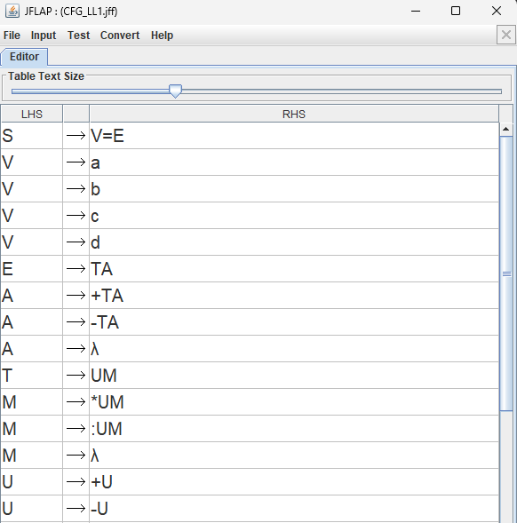
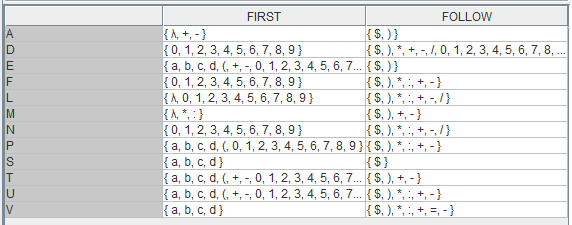
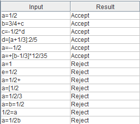
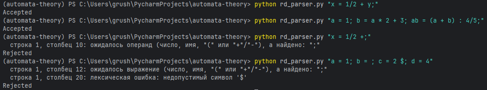
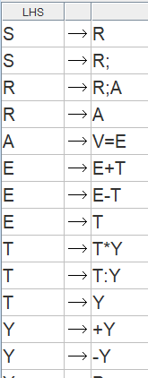
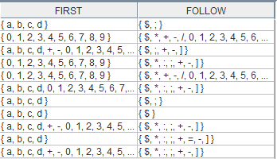
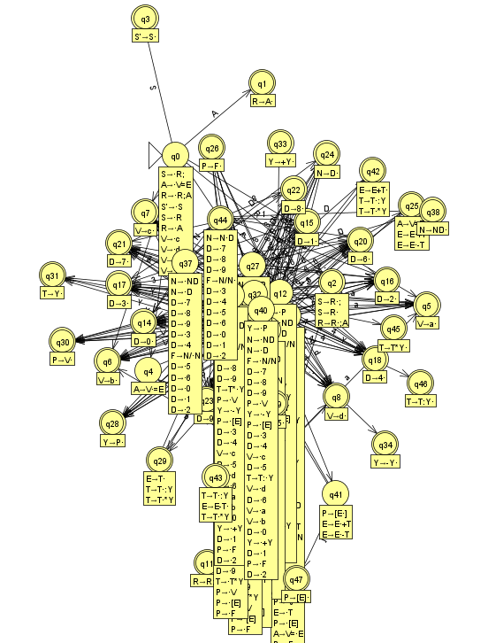
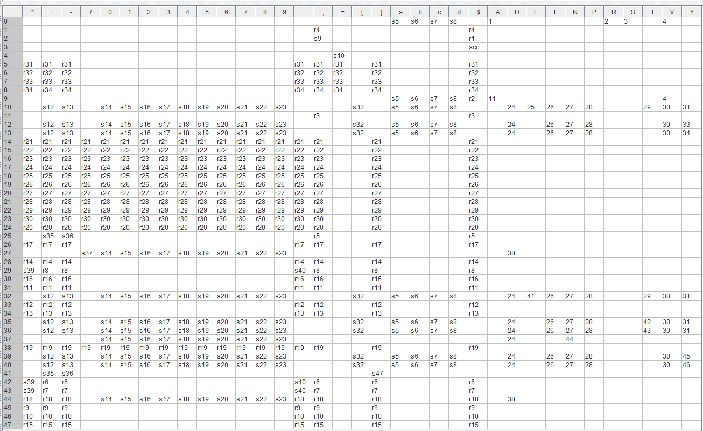
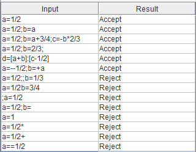

# Отчет по практической работе №5

|                |                                                                                                       |
|----------------|-------------------------------------------------------------------------------------------------------|
| **Дисциплина** | Теория автоматов, языков и вычислений                                                                 |
| **Тема**       | Синтаксический анализ контекстно-свободных языков: LL(1)-грамматики, метод рекурсивного спуска, SLR(1)-грамматики |
| **Вариант**    | № 10                                                                                                  |
| **Выполнил**   | Грушевский И. А. КИ24-16/1Б                                                                           |
| **Проверил**   | Мымликов В. Н.                                                                                        |

---

## 1. Цель работы

Исследование контекстно-свободных грамматик и алгоритмов синтаксического анализа контекстно-свободных языков: построение в системе JFLAP LL(1)- и SLR(1)-грамматик для заданных языков, формальное доказательство принадлежности грамматики классу LL(1), программная реализация синтаксического анализатора методом рекурсивного спуска.

---

## 2. Постановка задачи

Вариант № 10. Требуется:

**Часть 1.** С использованием JFLAP построить LL(1)-грамматику языка оператора присваивания, в правой части которого задано арифметическое выражение. Элементы выражений — значения, представляющие собой не смешанные дроби, имена переменных из одного символа (от `a` до `d`), знаки операций и скобки. Операции (в сторону уменьшения приоритета): унарные, бинарные, присваивание. Привести множества первых символов и символов-последователей, таблицу синтаксического анализа, примеры распознавания цепочек.

**Часть 2.** Реализовать синтаксический анализатор методом рекурсивного спуска для языка *последовательностей арифметических выражений*, элементами которых являются рациональные дроби, целочисленные константы в десятичной системе счисления, имена переменных из 1–2 символов, знаки операций и скобки. Операции (в сторону уменьшения приоритета): унарные, бинарные, присваивание. Формально доказать принадлежность лежащей в основе анализатора грамматики классу LL(1). Результат работы программы — сообщение «Accepted» или «Rejected».

**Часть 3.** С использованием JFLAP построить SLR(1)-грамматику языка *последовательностей операторов присваивания* с теми же элементами, что и в части 1 (не смешанные дроби, переменные `a`–`d`, унарные и бинарные операции). L-значением является только имя переменной. Привести множества первых символов и символов-последователей, канонический набор LR(0)-ситуаций, таблицу синтаксического анализа без конфликтов. Грамматика не должна повторять LL(1)-грамматику из части 1.

### 2.1. Принятые обозначения и соглашения

| Элемент | Запись |
|---|---|
| не смешанная дробь | `числитель/знаменатель`, числитель и знаменатель — непустые последовательности десятичных цифр, без пробелов (`1/2`, `12/35`) |
| целая константа (только часть 2) | непустая последовательность десятичных цифр (`42`) |
| имена переменных | части 1 и 3: `a`, `b`, `c`, `d`; часть 2: одна или две латинские буквы (`x`, `ab`) |
| унарные операции | `+`, `-` |
| бинарные мультипликативные | `*` (умножение), `:` (деление) |
| бинарные аддитивные | `+`, `-` |
| присваивание | `=` |
| разделитель операторов (части 2 и 3) | `;` (после последнего оператора допускается, но не обязателен) |

Соглашения:

* Знак деления записан как `:`, потому что символ `/` занят под дробную черту: иначе строка `1/2/3` допускала бы два разбора (дробь, делённая на число, или число, делённое на дробь), что нарушило бы однозначность грамматики.
* Приоритеты: унарные операции выше бинарных; среди бинарных мультипликативные выше аддитивных; присваивание — самая низкая. Так как «бинарные» в варианте не детализированы, они разбиты на обычные два уровня; множество допустимых цепочек от этого не зависит.
* В частях 1 и 3 присваивание — оператор вида `имя = выражение` (цепочки `a=b=1/2` не допускаются, как и в предыдущей работе). В части 2 присваивание — операция внутри выражения: она правоассоциативна и допускает цепочки `x = y = 1/2`, левым операндом всегда является имя переменной.
* В частях 1 и 3 язык задан на уровне символов (в JFLAP терминалы — отдельные символы, пробелов в цепочках нет). В части 2 анализатор работает с лексемами; пробелы и переводы строк между лексемами пропускаются.
* Нетерминалы JFLAP — заглавные латинские буквы; терминалы — строчные буквы, цифры и знаки.

---

## 3. Структура файлов проекта

* `CFG_LL1.jff` — LL(1)-грамматика языка (часть 1), 33 продукции;
* `rd_parser.py` — синтаксический анализатор методом рекурсивного спуска (часть 2);
* `CFG_SLR1.jff` — SLR(1)-грамматика языка (часть 3), 34 продукции;
* `images/` — скриншоты экспериментов в JFLAP и консольных запусков.

---

## 4. Теоретические сведения

**FIRST и FOLLOW.** Для цепочки α множество FIRST(α) — терминалы, с которых начинаются цепочки, выводимые из α (и ε, если α ⇒* ε). FOLLOW(A) — терминалы, которые могут стоять сразу после A в сентенциальных формах; маркер конца ввода `$` входит в FOLLOW аксиомы.

**LL(1)-грамматика.** Грамматика принадлежит классу LL(1) тогда и только тогда, когда для любых двух правил A → α и A → β с одной левой частью множества SELECT не пересекаются, где SELECT(A → α) = FIRST(α) ∪ FOLLOW(A) при α ⇒* ε и FIRST(α) в остальных случаях. Эквивалентно: (1) FIRST(α) ∩ FIRST(β) = ∅; (2) если α ⇒* ε, то FIRST(β) ∩ FOLLOW(A) = ∅. Следствия: LL(1)-грамматика однозначна и не имеет левой рекурсии. Анализатор нисходящий: читает вход слева направо, строит левый вывод, выбор правила определяется нетерминалом на вершине стека и одним символом предпросмотра.

**Метод рекурсивного спуска.** Каждому нетерминалу ставится в соответствие процедура, тело которой реализует выбор правила по символу предпросмотра: терминал сопоставляется с входом, нетерминал — вызов процедуры. Для LL(1)-грамматики такой анализатор детерминирован и не требует возвратов.

**SLR(1)-анализ.** Восходящий анализ: перенос-свёртка по таблице. LR(0)-ситуация — правило с точкой в правой части (`A → α·β`). Каноническая система строится из замыкания CLOSURE и переходов GOTO, начиная с ситуации `S' → ·S` пополненной грамматики. Таблица SLR(1): перенос `s j` по терминалу `a`, если `A → α·aβ ∈ I` и `GOTO(I, a) = j`; свёртка `r k` по правилу `A → α` на всех терминалах из FOLLOW(A), если `A → α· ∈ I`; допуск — в состоянии с `S' → S·` на `$`; переходы по нетерминалам — GOTO. Грамматика SLR(1), если в таблице нет клеток с несколькими действиями (конфликтов перенос/свёртка и свёртка/свёртка).

---

## 5. Часть 1. LL(1)-грамматика (JFLAP)

### 5.1. Обозначения нетерминалов

| Нетерминал | Назначение |
|---|---|
| `S` | оператор присваивания |
| `V` | имя переменной (`a`–`d`) |
| `E`, `A` | аддитивный уровень: терм и «хвост» из `+T` / `-T` |
| `T`, `M` | мультипликативный уровень: множитель и «хвост» из `*U` / `:U` |
| `U` | унарные операции |
| `P` | первичное выражение: дробь, переменная или выражение в скобках |
| `F` | не смешанная дробь `N/N` |
| `N`, `L` | непустая последовательность цифр: первая цифра и остаток |
| `D` | десятичная цифра |

### 5.2. Грамматика (`CFG_LL1.jff`)

```
S → V=E
V → a | b | c | d
E → TA
A → +TA | -TA | ε
T → UM
M → *UM | :UM | ε
U → +U | -U | P
P → F | V | [E]
F → N/N
N → DL
L → DL | ε
D → 0|1|…|9
```

**Обоснование.** Левая рекурсия, свойственная левоассоциативным операциям (`E → E+T`), заменена правой: `E → TA`, `A → +TA | -TA | ε` — аналогично для мультипликативного уровня (`T → UM`, `M → *UM | :UM | ε`) и для последовательности цифр (`N → DL`, `L → DL | ε`). Унарные операции правоассоциативны и записаны правой рекурсией `U → +U | -U | P`. Левое общее начало у правил `P` отсутствует: дробь начинается с цифры, переменная — с `a`–`d`, скобка — с `[`. Приоритеты обеспечены уровнями вложенности (от низшего к высшему): `S` (присваивание) → `E` (аддитивные) → `T` (мультипликативные) → `U` (унарные) → `P`. Ассоциативность бинарных операций в этой грамматике правая (следствие правой рекурсии, выбор разработчика); множество принимаемых цепочек от неё не зависит.



### 5.3. Множества FIRST и FOLLOW

Запись `0–9` означает все десять цифр, `a–d` — четыре буквы; `$` — конец ввода.

| Нетерминал | FIRST | FOLLOW |
|---|---|---|
| `S` | `a–d` | `$` |
| `V` | `a–d` | `+`, `-`, `*`, `:`, `=`, `]`, `$` |
| `E` | `0–9`, `a–d`, `+`, `-`, `[` | `]`, `$` |
| `A` | `+`, `-` (и ε) | `]`, `$` |
| `T` | `0–9`, `a–d`, `+`, `-`, `[` | `+`, `-`, `]`, `$` |
| `M` | `*`, `:` (и ε) | `+`, `-`, `]`, `$` |
| `U` | `0–9`, `a–d`, `+`, `-`, `[` | `+`, `-`, `*`, `:`, `]`, `$` |
| `P` | `0–9`, `a–d`, `[` | `+`, `-`, `*`, `:`, `]`, `$` |
| `F` | `0–9` | `+`, `-`, `*`, `:`, `]`, `$` |
| `N` | `0–9` | `+`, `-`, `*`, `:`, `]`, `/`, `$` |
| `L` | `0–9` (и ε) | `+`, `-`, `*`, `:`, `]`, `/`, `$` |
| `D` | `0–9` | `0–9`, `+`, `-`, `*`, `:`, `]`, `/`, `$` |

### 5.4. Таблица синтаксического анализа LL(1)

В клетке — правило, применяемое при данном нетерминале на вершине стека и данном символе предпросмотра; пустая клетка — ошибка. Столбцы `0–9` и `a–d` объединяют по 10 и 4 одинаковых столбца; в строке `D` в клетке указано правило `D → c`, где `c` — сама цифра, в строке `V` — `V → x`, где `x` — сама буква. Ни в одной клетке нет двух правил, следовательно, грамматика принадлежит классу LL(1).

|  | 0–9 | a–d | `+` | `-` | `*` | `:` | `=` | `[` | `]` | `/` | `$` |
|---|---|---|---|---|---|---|---|---|---|---|---|
| `S` |  | `S → V=E` |  |  |  |  |  |  |  |  |  |
| `V` |  | `V → x` |  |  |  |  |  |  |  |  |  |
| `E` | `E → TA` | `E → TA` | `E → TA` | `E → TA` |  |  |  | `E → TA` |  |  |  |
| `A` |  |  | `A → +TA` | `A → -TA` |  |  |  |  | `A → ε` |  | `A → ε` |
| `T` | `T → UM` | `T → UM` | `T → UM` | `T → UM` |  |  |  | `T → UM` |  |  |  |
| `M` |  |  | `M → ε` | `M → ε` | `M → *UM` | `M → :UM` |  |  | `M → ε` |  | `M → ε` |
| `U` | `U → P` | `U → P` | `U → +U` | `U → -U` |  |  |  | `U → P` |  |  |  |
| `P` | `P → F` | `P → V` |  |  |  |  |  | `P → [E]` |  |  |  |
| `F` | `F → N/N` |  |  |  |  |  |  |  |  |  |  |
| `N` | `N → DL` |  |  |  |  |  |  |  |  |  |  |
| `L` | `L → DL` |  | `L → ε` | `L → ε` | `L → ε` | `L → ε` |  |  | `L → ε` | `L → ε` | `L → ε` |
| `D` | `D → c` |  |  |  |  |  |  |  |  |  |  |



### 5.5. Пример разбора

Цепочка `a=1/2+b`. Левый вывод, построенный анализатором по таблице:

```
S ⇒ V=E ⇒ a=E ⇒ a=TA ⇒ a=UMA
⇒ a=PMA ⇒ a=FMA ⇒ a=N/NMA ⇒ a=DL/NMA ⇒ a=1L/NMA
⇒ a=1/NMA ⇒ a=1/DLMA ⇒ a=1/2LMA ⇒ a=1/2MA ⇒ a=1/2A
⇒ a=1/2+TA ⇒ a=1/2+UMA ⇒ a=1/2+PMA ⇒ a=1/2+VMA ⇒ a=1/2+bMA
⇒ a=1/2+bA ⇒ a=1/2+b
```

### 5.6. Верификация

Тестирование в JFLAP: **Input → Build LL(1) Parse Table**, затем ввод цепочки.

| № | Цепочка | Принадлежит языку | Результат | Пояснение |
|---|---|---|---|---|
| 1 | `a=1/2` | да | принята | простая дробь |
| 2 | `b=3/4+c` | да | принята | дробь и переменная, аддитивная операция |
| 3 | `c=-1/2*d` | да | принята | унарный минус, мультипликативная операция |
| 4 | `d=[a+1/3]:2/5` | да | принята | скобки, знак деления `:` |
| 5 | `a=--1/2` | да | принята | цепочка унарных знаков |
| 6 | `a=+[b-1/3]*12/35` | да | принята | унарный плюс, многозначные числитель и знаменатель |
| 7 | `a=1` | нет | отвергнута | целая константа не является дробью |
| 8 | `e=1/2` | нет | отвергнута | имя переменной вне диапазона a–d |
| 9 | `a=1/2+` | нет | отвергнута | нет правого операнда |
| 10 | `a=[1/2` | нет | отвергнута | не закрыта скобка |
| 11 | `a=1/2/3` | нет | отвергнута | два знаменателя |
| 12 | `a=b=1/2` | нет | отвергнута | цепочечное присваивание не допускается |
| 13 | `1/2=a` | нет | отвергнута | слева не имя переменной |
| 14 | `a=1/2b` | нет | отвергнута | два операнда подряд |



---

## 6. Часть 2. Метод рекурсивного спуска (`rd_parser.py`)

### 6.1. Язык и лексемы

Язык — непустая последовательность выражений, разделённых `;`. Лексический анализ выполняется до синтаксического; пробелы, табуляции и переводы строк пропускаются.

| Лексема | Определение | Терминал грамматики |
|---|---|---|
| число | `[0-9]+` (целое) или `[0-9]+/[0-9]+` (рациональная дробь) | `n` |
| имя | одна или две латинские буквы | `i` |
| знаки | `+` `-` `*` `:` `=` `(` `)` `;` | сами символы |

Всё остальное — лексическая ошибка: символ вне алфавита; дробь без знаменателя (`1/`); имя длиннее двух букв (`abc`); `/` вне дроби (например `1/2/3` или `1 / 2`).

### 6.2. Грамматика

Исходная («естественная») грамматика языка неоднозначна и леворекурсивна (`Arith → Arith + Arith`), а у `Expr → Id = Expr | Arith` два правила могут начинаться с имени, поэтому LL(1) она не является. Преобразования: устранение левой рекурсии (`R`, `A`), левая факторизация общего начала `Id` (нетерминал `T` — «что следует за именем: `=` или продолжение арифметического выражения»), разделение уровней приоритетов. Левый операнд присваивания остаётся строго именем: после `i` допускается `=`, а после числа, скобок или унарного знака — нет.

```
S → EQ
Q → ;K | ε
K → EQ | ε
E → iT | nRA | (E)RA | +URA | -URA
T → =E | RA
U → +U | -U | n | i | (E)
R → *UR | :UR | ε
A → +MA | -MA | ε
M → UR
```

| Нетерминал | Процедура | Назначение |
|---|---|---|
| `S` | `program` | вся последовательность |
| `Q` | `program (цикл)` | остаток после первого выражения |
| `K` | `program (цикл)` | выражение после `;` либо конец |
| `E` | `expr` | выражение с присваиванием |
| `T` | `tail` | продолжение после имени |
| `U` | `unary` | унарные знаки и операнд |
| `R` | `mul_rest` | хвост мультипликативных операций |
| `A` | `add_rest` | хвост аддитивных операций |
| `M` | `mul` | множитель аддитивного уровня |

### 6.3. Множества FIRST и FOLLOW

(Терминалы: `i` — имя, `n` — число.)

| Нетерминал | FIRST | FOLLOW |
|---|---|---|
| `S` | `+`, `-`, `(`, `i`, `n` | `$` |
| `Q` | `;` (и ε) | `$` |
| `K` | `+`, `-`, `(`, `i`, `n` (и ε) | `$` |
| `E` | `+`, `-`, `(`, `i`, `n` | `;`, `)`, `$` |
| `T` | `+`, `-`, `*`, `:`, `=` (и ε) | `;`, `)`, `$` |
| `U` | `+`, `-`, `(`, `i`, `n` | `+`, `-`, `*`, `:`, `;`, `)`, `$` |
| `R` | `*`, `:` (и ε) | `+`, `-`, `;`, `)`, `$` |
| `A` | `+`, `-` (и ε) | `;`, `)`, `$` |
| `M` | `+`, `-`, `(`, `i`, `n` | `+`, `-`, `;`, `)`, `$` |

### 6.4. Формальное доказательство принадлежности к классу LL(1)

**Утверждение.** Грамматика части 2 принадлежит классу LL(1).

**Доказательство.** По критерию из раздела 4 достаточно проверить, что для каждого нетерминала с несколькими правилами множества SELECT этих правил попарно не пересекаются. Нетерминалы с единственным правилом (`M → UR`, `S → EQ`) условия не требуют. Множества SELECT вычислены из FIRST и FOLLOW (раздел 6.3):

| Правило | SELECT = FIRST(α) ∪ (FOLLOW(A), если α ⇒* ε) | Пересечение с другими правилами того же нетерминала |
|---|---|---|
| `S → EQ` | `i`, `n`, `+`, `-`, `(` | — (одно правило) |
| `Q → ;K` | `;` | ∅ |
| `Q → ε` | `$` | ∅ |
| `K → EQ` | `i`, `n`, `+`, `-`, `(` | ∅ |
| `K → ε` | `$` | ∅ |
| `E → iT` | `i` | ∅ |
| `E → nRA` | `n` | ∅ |
| `E → (E)RA` | `(` | ∅ |
| `E → +URA` | `+` | ∅ |
| `E → -URA` | `-` | ∅ |
| `T → =E` | `=` | ∅ |
| `T → RA` | `+`, `-`, `*`, `:`, `)`, `;`, `$` | ∅ |
| `U → +U` | `+` | ∅ |
| `U → -U` | `-` | ∅ |
| `U → n` | `n` | ∅ |
| `U → i` | `i` | ∅ |
| `U → (E)` | `(` | ∅ |
| `R → *UR` | `*` | ∅ |
| `R → :UR` | `:` | ∅ |
| `R → ε` | `+`, `-`, `)`, `;`, `$` | ∅ |
| `A → +MA` | `+` | ∅ |
| `A → -MA` | `-` | ∅ |
| `A → ε` | `)`, `;`, `$` | ∅ |
| `M → UR` | `i`, `n`, `+`, `-`, `(` | — (одно правило) |

Разбор по нетерминалам:

* `Q`: `;` ∈ SELECT(`Q → ;K`), `$` ∈ SELECT(`Q → ε`) (так как `$` ∈ FOLLOW(`Q`) = FOLLOW(`S`)); `;` ≠ `$`.
* `K`: FIRST(`EQ`) = {`i`, `n`, `(`, `+`, `-`}, а FOLLOW(`K`) = {`$`}; пересечения нет.
* `E`: правила начинаются с пяти различных терминалов `i`, `n`, `(`, `+`, `-`; ни одно правило не выводит ε.
* `T`: SELECT(`T → =E`) = {`=`}; SELECT(`T → RA`) = {`*`, `:`, `+`, `-`} ∪ FOLLOW(`T`) = {`*`, `:`, `+`, `-`, `;`, `)`, `$`}. Символ `=` не входит в FOLLOW(`E`) = {`;`, `)`, `$`} = FOLLOW(`T`) — именно поэтому присваивание нельзя применить к результату бинарной операции. Пересечение пусто.
* `U`: пять правил начинаются с пяти различных терминалов `+`, `-`, `n`, `i`, `(`.
* `R`: `*`, `:` против FOLLOW(`R`) = {`+`, `-`, `;`, `)`, `$`}; пересечения нет (за `R` следует либо `A`, начинающийся с `+` или `-`, либо то, что следует за `M`, `T` или `E`).
* `A`: `+`, `-` против FOLLOW(`A`) = {`;`, `)`, `$`}; пересечения нет.

Левой рекурсии нет: рассмотрим отношение «нетерминал `B` может стоять первым в выводе из `A`» (с учётом ε-выводимых префиксов): `S → E`, `K → E`, `M → U`, `T → R`, `T → A`; остальные нетерминалы (`E`, `U`, `R`, `A`, `Q`) начинаются с терминала. Граф отношения ацикличен, поэтому ни один нетерминал не выводит цепочку, начинающуюся с него самого. Следовательно, условия критерия выполнены для всех нетерминалов, грамматика LL(1). ∎

Таблица LL(1) (пустая клетка — ошибка), построенная по этим множествам, не содержит клеток с двумя правилами:

|  | `i` | `n` | `+` | `-` | `*` | `:` | `=` | `(` | `)` | `;` | `$` |
|---|---|---|---|---|---|---|---|---|---|---|---|
| `S` | `S → EQ` | `S → EQ` | `S → EQ` | `S → EQ` |  |  |  | `S → EQ` |  |  |  |
| `Q` |  |  |  |  |  |  |  |  |  | `Q → ;K` | `Q → ε` |
| `K` | `K → EQ` | `K → EQ` | `K → EQ` | `K → EQ` |  |  |  | `K → EQ` |  |  | `K → ε` |
| `E` | `E → iT` | `E → nRA` | `E → +URA` | `E → -URA` |  |  |  | `E → (E)RA` |  |  |  |
| `T` |  |  | `T → RA` | `T → RA` | `T → RA` | `T → RA` | `T → =E` |  | `T → RA` | `T → RA` | `T → RA` |
| `U` | `U → i` | `U → n` | `U → +U` | `U → -U` |  |  |  | `U → (E)` |  |  |  |
| `R` |  |  | `R → ε` | `R → ε` | `R → *UR` | `R → :UR` |  |  | `R → ε` | `R → ε` | `R → ε` |
| `A` |  |  | `A → +MA` | `A → -MA` |  |  |  |  | `A → ε` | `A → ε` | `A → ε` |
| `M` | `M → UR` | `M → UR` | `M → UR` | `M → UR` |  |  |  | `M → UR` |  |  |  |

### 6.5. Реализация

* **Лексер** `tokenize()` — конечный автомат по символам; возвращает лексемы `NUM`, `ID`, знаки, `EOF` и лексемы-ошибки `BAD` с текстом диагностики.
* **Парсер** — класс `Parser`; по одной процедуре на нетерминал (`program`, `expr`, `tail`, `unary`, `mul`, `mul_rest`, `add_rest`), выбор правила по текущей лексеме (`cur.kind`). ε-правила `R → ε`, `A → ε` выбираются, когда лексема входит в FOLLOW (`FOLLOW_R`, `FOLLOW_A` в коде) — на любой другой лексеме вызывается `fail()`. Хвостовые рекурсии `R → *UR`, `A → +MA`, `Q → ;K` реализованы циклами (`while`), что эквивалентно рекурсивному спуску по правилам.
* **Диагностика и восстановление (бонус).** При ошибке формируется сообщение «строка, столбец, что ожидалось и что найдено» (лексические ошибки — с описанием причины); затем анализатор пропускает вход до ближайшего `;` и продолжает со следующего выражения, поэтому за один запуск сообщается обо всех ошибочных выражениях. В stdout всегда выводится одно слово `Accepted` или `Rejected`, диагностика идёт в stderr.

Запуск:

```
python rd_parser.py "x = 1/2 + y; z = -(x : 3)"
```

### 6.6. Тестовые примеры

| № | Входной текст | Вывод программы | Диагностика (stderr) |
|---|---|---|---|
| 1 | `x = 1/2 + y;` | **Accepted** | — |
| 2 | `x = y = 3/4; z = -(x : 2)` | **Accepted** | — |
| 3 | `a = 1; b = a * 2 + 3; ab = (a + b) : 4/5;` | **Accepted** | — |
| 4 | `-x + +y * 2/3` | **Accepted** | — |
| 5 | `42` | **Accepted** | — |
| 6 | `x = 1/2 +;` | **Rejected** | строка 1, столбец 10: ожидалось: операнд (число, имя, «(» или унарный знак); найдено: «;» |
| 7 | `x = (1 + 2;` | **Rejected** | строка 1, столбец 11: ожидалось: «)»; найдено: «;» |
| 8 | `abc = 5;` | **Rejected** | строка 1, столбец 1: лексическая ошибка: имя «abc» длиннее двух символов |
| 9 | `x + 1 = 3;` | **Rejected** | строка 1, столбец 7: ожидалось: бинарная операция, «)», «;» или конец ввода; найдено: «=» |
| 10 | `x = 1/2/3;` | **Rejected** | строка 1, столбец 8: лексическая ошибка: недопустимый символ '/' («/» допустим только внутри дроби; деление записывается «:») |
| 11 | `x = 1 / 2;` | **Rejected** | строка 1, столбец 7: лексическая ошибка: недопустимый символ '/' («/» допустим только внутри дроби; деление записывается «:») |
| 12 | `a = 1; b = ; c = 2 $; d = 4` | **Rejected** | строка 1, столбец 12: ожидалось: выражение (число, имя, «(» или унарный знак); найдено: «;»<br>строка 1, столбец 20: лексическая ошибка: недопустимый символ '$' |
| 13 | *(пустой ввод)* | **Rejected** | строка 1, столбец 1: ожидалось: выражение (число, имя, «(» или унарный знак); найдено: конец ввода |
| 14 | `x = 2 3;` | **Rejected** | строка 1, столбец 7: ожидалось: бинарная операция, «)», «;» или конец ввода; найдено: число «3» |
| 15 | `1/ = 2;` | **Rejected** | строка 1, столбец 1: лексическая ошибка: в дроби «1/» нет знаменателя |



---

## 7. Часть 3. SLR(1)-грамматика (JFLAP)

### 7.1. Грамматика (`CFG_SLR1.jff`)

```
S → R | R;
R → R;A | A
A → V=E
E → E+T | E-T | T
T → T*Y | T:Y | Y
Y → +Y | -Y | P
P → [E] | V | F
F → N/N
N → ND | D
D → 0|1|…|9
V → a | b | c | d
```

Нумерация правил (используется в таблице):

| № | Правило |
|---|---|
| 1 | `S → R` |
| 2 | `S → R;` |
| 3 | `R → R;A` |
| 4 | `R → A` |
| 5 | `A → V=E` |
| 6 | `E → E+T` |
| 7 | `E → E-T` |
| 8 | `E → T` |
| 9 | `T → T*Y` |
| 10 | `T → T:Y` |
| 11 | `T → Y` |
| 12 | `Y → +Y` |
| 13 | `Y → -Y` |
| 14 | `Y → P` |
| 15 | `P → [E]` |
| 16 | `P → V` |
| 17 | `P → F` |
| 18 | `F → N/N` |
| 19 | `N → ND` |
| 20 | `N → D` |
| 21–30 | D → 0 \| 1 \| … \| 9 |
| 31–34 | V → a \| b \| c \| d |

**Отличие от LL(1)-грамматики части 1.** Грамматика части 3 леворекурсивна по всем бинарным уровням (`E → E+T | E-T`, `T → T*Y | T:Y`), по последовательности операторов (`R → R;A`) и по цифрам (`N → ND`); в ней нет нетерминалов `M`, `L`, `U` и ε-правил, у присваивания отдельный нетерминал `A`, а первичное выражение и унарный уровень переименованы (`Y`, `P`). Ассоциативность бинарных операций левая. Левая рекурсия недопустима в LL(1)-грамматике (раздел 4), поэтому грамматика части 3 не совпадает с LL(1)-грамматикой части 1 и не может быть LL(1) без преобразования. Однозначность и приоритеты обеспечены теми же уровнями, что и в части 1: `E` (аддитивные) → `T` (мультипликативные) → `Y` (унарные) → `P` (от низшего приоритета к высшему). Нетерминал `S` не встречается в правых частях.



### 7.2. Множества FIRST и FOLLOW

| Нетерминал | FIRST | FOLLOW |
|---|---|---|
| `S` | `a–d` | `$` |
| `R` | `a–d` | `;`, `$` |
| `A` | `a–d` | `;`, `$` |
| `E` | `0–9`, `a–d`, `+`, `-`, `[` | `+`, `-`, `]`, `;`, `$` |
| `T` | `0–9`, `a–d`, `+`, `-`, `[` | `+`, `-`, `*`, `:`, `]`, `;`, `$` |
| `Y` | `0–9`, `a–d`, `+`, `-`, `[` | `+`, `-`, `*`, `:`, `]`, `;`, `$` |
| `P` | `0–9`, `a–d`, `[` | `+`, `-`, `*`, `:`, `]`, `;`, `$` |
| `F` | `0–9` | `+`, `-`, `*`, `:`, `]`, `;`, `$` |
| `N` | `0–9` | `0–9`, `+`, `-`, `*`, `:`, `]`, `/`, `;`, `$` |
| `D` | `0–9` | `0–9`, `+`, `-`, `*`, `:`, `]`, `/`, `;`, `$` |
| `V` | `a–d` | `+`, `-`, `*`, `:`, `=`, `]`, `;`, `$` |



### 7.3. Канонический набор LR(0)-ситуаций

Пополненное правило `S' → S` имеет номер 0. Всего в системе **48 состояний**; в таблице ниже 34 основных состояния `I0`–`I33`, а 14 состояний вида `D → c·` (10 цифр) и `V → x·` (4 буквы) для краткости свёрнуты в два обозначения `d_c` и `v_x`. Замыкания ситуаций `D → ·c` и `V → ·x` также записаны сжато. Нумерация состояний в JFLAP может отличаться от приведённой.

| Состояние | Ситуации (ядро и замыкание) | Переходы |
|---|---|---|
| I0 | `S' → ·S`<br>`S → ·R`<br>`S → ·R;`<br>`R → ·R;A`<br>`R → ·A`<br>`A → ·V=E`<br>`V → ·x  (x = a…d)` | `S`→1, `R`→2, `A`→3, `V`→4, `a–d`→v_x |
| I1 | `S' → S·` |  |
| I2 | `S → R·`<br>`S → R·;`<br>`R → R·;A` | `;`→5 |
| I3 | `R → A·` |  |
| I4 | `A → V·=E` | `=`→6 |
| I5 | `S → R;·`<br>`R → R;·A`<br>`A → ·V=E`<br>`V → ·x  (x = a…d)` | `A`→7, `V`→4, `a–d`→v_x |
| I6 | `A → V=·E`<br>`E → ·E+T`<br>`E → ·E-T`<br>`E → ·T`<br>`T → ·T*Y`<br>`T → ·T:Y`<br>`T → ·Y`<br>`Y → ·+Y`<br>`Y → ·-Y`<br>`Y → ·P`<br>`P → ·[E]`<br>`P → ·V`<br>`P → ·F`<br>`F → ·N/N`<br>`N → ·ND`<br>`N → ·D`<br>`D → ·c  (c = 0…9)`<br>`V → ·x  (x = a…d)` | `E`→8, `T`→9, `Y`→10, `P`→11, `F`→12, `N`→13, `D`→14, `V`→15, `+`→16, `-`→17, `[`→18, `0–9`→d_c, `a–d`→v_x |
| I7 | `R → R;A·` |  |
| I8 | `A → V=E·`<br>`E → E·+T`<br>`E → E·-T` | `+`→19, `-`→20 |
| I9 | `E → T·`<br>`T → T·*Y`<br>`T → T·:Y` | `*`→21, `:`→22 |
| I10 | `T → Y·` |  |
| I11 | `Y → P·` |  |
| I12 | `P → F·` |  |
| I13 | `F → N·/N`<br>`N → N·D`<br>`D → ·c  (c = 0…9)` | `D`→23, `/`→24, `0–9`→d_c |
| I14 | `N → D·` |  |
| I15 | `P → V·` |  |
| I16 | `Y → +·Y`<br>`Y → ·+Y`<br>`Y → ·-Y`<br>`Y → ·P`<br>`P → ·[E]`<br>`P → ·V`<br>`P → ·F`<br>`F → ·N/N`<br>`N → ·ND`<br>`N → ·D`<br>`D → ·c  (c = 0…9)`<br>`V → ·x  (x = a…d)` | `Y`→25, `P`→11, `F`→12, `N`→13, `D`→14, `V`→15, `+`→16, `-`→17, `[`→18, `0–9`→d_c, `a–d`→v_x |
| I17 | `Y → -·Y`<br>`Y → ·+Y`<br>`Y → ·-Y`<br>`Y → ·P`<br>`P → ·[E]`<br>`P → ·V`<br>`P → ·F`<br>`F → ·N/N`<br>`N → ·ND`<br>`N → ·D`<br>`D → ·c  (c = 0…9)`<br>`V → ·x  (x = a…d)` | `Y`→26, `P`→11, `F`→12, `N`→13, `D`→14, `V`→15, `+`→16, `-`→17, `[`→18, `0–9`→d_c, `a–d`→v_x |
| I18 | `P → [·E]`<br>`E → ·E+T`<br>`E → ·E-T`<br>`E → ·T`<br>`T → ·T*Y`<br>`T → ·T:Y`<br>`T → ·Y`<br>`Y → ·+Y`<br>`Y → ·-Y`<br>`Y → ·P`<br>`P → ·[E]`<br>`P → ·V`<br>`P → ·F`<br>`F → ·N/N`<br>`N → ·ND`<br>`N → ·D`<br>`D → ·c  (c = 0…9)`<br>`V → ·x  (x = a…d)` | `E`→27, `T`→9, `Y`→10, `P`→11, `F`→12, `N`→13, `D`→14, `V`→15, `+`→16, `-`→17, `[`→18, `0–9`→d_c, `a–d`→v_x |
| I19 | `E → E+·T`<br>`T → ·T*Y`<br>`T → ·T:Y`<br>`T → ·Y`<br>`Y → ·+Y`<br>`Y → ·-Y`<br>`Y → ·P`<br>`P → ·[E]`<br>`P → ·V`<br>`P → ·F`<br>`F → ·N/N`<br>`N → ·ND`<br>`N → ·D`<br>`D → ·c  (c = 0…9)`<br>`V → ·x  (x = a…d)` | `T`→28, `Y`→10, `P`→11, `F`→12, `N`→13, `D`→14, `V`→15, `+`→16, `-`→17, `[`→18, `0–9`→d_c, `a–d`→v_x |
| I20 | `E → E-·T`<br>`T → ·T*Y`<br>`T → ·T:Y`<br>`T → ·Y`<br>`Y → ·+Y`<br>`Y → ·-Y`<br>`Y → ·P`<br>`P → ·[E]`<br>`P → ·V`<br>`P → ·F`<br>`F → ·N/N`<br>`N → ·ND`<br>`N → ·D`<br>`D → ·c  (c = 0…9)`<br>`V → ·x  (x = a…d)` | `T`→29, `Y`→10, `P`→11, `F`→12, `N`→13, `D`→14, `V`→15, `+`→16, `-`→17, `[`→18, `0–9`→d_c, `a–d`→v_x |
| I21 | `T → T*·Y`<br>`Y → ·+Y`<br>`Y → ·-Y`<br>`Y → ·P`<br>`P → ·[E]`<br>`P → ·V`<br>`P → ·F`<br>`F → ·N/N`<br>`N → ·ND`<br>`N → ·D`<br>`D → ·c  (c = 0…9)`<br>`V → ·x  (x = a…d)` | `Y`→30, `P`→11, `F`→12, `N`→13, `D`→14, `V`→15, `+`→16, `-`→17, `[`→18, `0–9`→d_c, `a–d`→v_x |
| I22 | `T → T:·Y`<br>`Y → ·+Y`<br>`Y → ·-Y`<br>`Y → ·P`<br>`P → ·[E]`<br>`P → ·V`<br>`P → ·F`<br>`F → ·N/N`<br>`N → ·ND`<br>`N → ·D`<br>`D → ·c  (c = 0…9)`<br>`V → ·x  (x = a…d)` | `Y`→31, `P`→11, `F`→12, `N`→13, `D`→14, `V`→15, `+`→16, `-`→17, `[`→18, `0–9`→d_c, `a–d`→v_x |
| I23 | `N → ND·` |  |
| I24 | `F → N/·N`<br>`N → ·ND`<br>`N → ·D`<br>`D → ·c  (c = 0…9)` | `N`→32, `D`→14, `0–9`→d_c |
| I25 | `Y → +Y·` |  |
| I26 | `Y → -Y·` |  |
| I27 | `E → E·+T`<br>`E → E·-T`<br>`P → [E·]` | `+`→19, `-`→20, `]`→33 |
| I28 | `E → E+T·`<br>`T → T·*Y`<br>`T → T·:Y` | `*`→21, `:`→22 |
| I29 | `E → E-T·`<br>`T → T·*Y`<br>`T → T·:Y` | `*`→21, `:`→22 |
| I30 | `T → T*Y·` |  |
| I31 | `T → T:Y·` |  |
| I32 | `F → N/N·`<br>`N → N·D`<br>`D → ·c  (c = 0…9)` | `D`→23, `0–9`→d_c |
| I33 | `P → [E]·` |  |
| I d_c  (c = 0…9) | `D → c·` | — |
| I v_x  (x = a…d) | `V → x·` | — |



### 7.4. Таблица синтаксического анализа SLR(1)

Запись `s j` — перенос и переход в состояние `j`; `r k` — свёртка по правилу № `k`; `acc` — допуск; пустая клетка — ошибка. Столбцы `0–9` и `a–d` объединяют 10 и 4 одинаковых столбца: `s d_c` — перенос в состояние `d_c` для прочитанной цифры `c`, `s v_x` — для прочитанной буквы `x`. Строки `d_c` и `v_x` — свёртки `D → c`, `V → x` (соответственно правила 21–30 и 31–34).

Конфликтов нет: в каждой клетке не более одного действия. Контрольные места:

* состояния 9, 28, 29 (`E → T·`, `E → E+T·`, `E → E-T·` и `T → T·*Y`, `T → T·:Y`): свёртка выполняется по FOLLOW(`E`) = {`+`, `-`, `)`, `;`, `$`}, перенос — по `*` и `:`; множества не пересекаются;
* состояние 2 (`S → R·`, `S → R·;`, `R → R·;A`): свёртка по `$`, перенос по `;`;
* состояния 13 и 32 (`F → N·/N` / `F → N/N·` и `N → N·D`): перенос по цифрам и `/`, а свёртка `F → N/N` — только по FOLLOW(`F`), в котором нет цифр;
* состояние 4 (`A → V·=E`): единственное действие — перенос `=`; в состоянии 15 (`P → V·`) свёртка по FOLLOW(`P`), где нет `=`; именно поэтому имя слева от `=` и имя в выражении не конфликтуют (они возникают в разных состояниях).

| Сост. | 0–9 | a–d | `+` | `-` | `*` | `:` | `=` | `(` | `)` | `/` | `;` | `$` | S | R | A | E | T | Y | P | F | N | D | V |
|---|---|---|---|---|---|---|---|---|---|---|---|---|---|---|---|---|---|---|---|---|---|---|---|
| 0 |  | s v_x |  |  |  |  |  |  |  |  |  |  | 1 | 2 | 3 |  |  |  |  |  |  |  | 4 |
| 1 |  |  |  |  |  |  |  |  |  |  |  | acc |  |  |  |  |  |  |  |  |  |  |  |
| 2 |  |  |  |  |  |  |  |  |  |  | s5 | r1 |  |  |  |  |  |  |  |  |  |  |  |
| 3 |  |  |  |  |  |  |  |  |  |  | r4 | r4 |  |  |  |  |  |  |  |  |  |  |  |
| 4 |  |  |  |  |  |  | s6 |  |  |  |  |  |  |  |  |  |  |  |  |  |  |  |  |
| 5 |  | s v_x |  |  |  |  |  |  |  |  |  | r2 |  |  | 7 |  |  |  |  |  |  |  | 4 |
| 6 | s d_c | s v_x | s16 | s17 |  |  |  |  |  |  |  |  |  |  |  | 8 | 9 | 10 | 11 | 12 | 13 | 14 | 15 |
| 7 |  |  |  |  |  |  |  |  |  |  | r3 | r3 |  |  |  |  |  |  |  |  |  |  |  |
| 8 |  |  | s19 | s20 |  |  |  |  |  |  | r5 | r5 |  |  |  |  |  |  |  |  |  |  |  |
| 9 |  |  | r8 | r8 | s21 | s22 |  |  |  |  | r8 | r8 |  |  |  |  |  |  |  |  |  |  |  |
| 10 |  |  | r11 | r11 | r11 | r11 |  |  |  |  | r11 | r11 |  |  |  |  |  |  |  |  |  |  |  |
| 11 |  |  | r14 | r14 | r14 | r14 |  |  |  |  | r14 | r14 |  |  |  |  |  |  |  |  |  |  |  |
| 12 |  |  | r17 | r17 | r17 | r17 |  |  |  |  | r17 | r17 |  |  |  |  |  |  |  |  |  |  |  |
| 13 | s d_c |  |  |  |  |  |  |  |  | s24 |  |  |  |  |  |  |  |  |  |  |  | 23 |  |
| 14 | r20 |  | r20 | r20 | r20 | r20 |  |  |  | r20 | r20 | r20 |  |  |  |  |  |  |  |  |  |  |  |
| 15 |  |  | r16 | r16 | r16 | r16 |  |  |  |  | r16 | r16 |  |  |  |  |  |  |  |  |  |  |  |
| 16 | s d_c | s v_x | s16 | s17 |  |  |  |  |  |  |  |  |  |  |  |  |  | 25 | 11 | 12 | 13 | 14 | 15 |
| 17 | s d_c | s v_x | s16 | s17 |  |  |  |  |  |  |  |  |  |  |  |  |  | 26 | 11 | 12 | 13 | 14 | 15 |
| 18 | s d_c | s v_x | s16 | s17 |  |  |  |  |  |  |  |  |  |  |  | 27 | 9 | 10 | 11 | 12 | 13 | 14 | 15 |
| 19 | s d_c | s v_x | s16 | s17 |  |  |  |  |  |  |  |  |  |  |  |  | 28 | 10 | 11 | 12 | 13 | 14 | 15 |
| 20 | s d_c | s v_x | s16 | s17 |  |  |  |  |  |  |  |  |  |  |  |  | 29 | 10 | 11 | 12 | 13 | 14 | 15 |
| 21 | s d_c | s v_x | s16 | s17 |  |  |  |  |  |  |  |  |  |  |  |  |  | 30 | 11 | 12 | 13 | 14 | 15 |
| 22 | s d_c | s v_x | s16 | s17 |  |  |  |  |  |  |  |  |  |  |  |  |  | 31 | 11 | 12 | 13 | 14 | 15 |
| 23 | r19 |  | r19 | r19 | r19 | r19 |  |  |  | r19 | r19 | r19 |  |  |  |  |  |  |  |  |  |  |  |
| 24 | s d_c |  |  |  |  |  |  |  |  |  |  |  |  |  |  |  |  |  |  |  | 32 | 14 |  |
| 25 |  |  | r12 | r12 | r12 | r12 |  |  |  |  | r12 | r12 |  |  |  |  |  |  |  |  |  |  |  |
| 26 |  |  | r13 | r13 | r13 | r13 |  |  |  |  | r13 | r13 |  |  |  |  |  |  |  |  |  |  |  |
| 27 |  |  | s19 | s20 |  |  |  |  |  |  |  |  |  |  |  |  |  |  |  |  |  |  |  |
| 28 |  |  | r6 | r6 | s21 | s22 |  |  |  |  | r6 | r6 |  |  |  |  |  |  |  |  |  |  |  |
| 29 |  |  | r7 | r7 | s21 | s22 |  |  |  |  | r7 | r7 |  |  |  |  |  |  |  |  |  |  |  |
| 30 |  |  | r9 | r9 | r9 | r9 |  |  |  |  | r9 | r9 |  |  |  |  |  |  |  |  |  |  |  |
| 31 |  |  | r10 | r10 | r10 | r10 |  |  |  |  | r10 | r10 |  |  |  |  |  |  |  |  |  |  |  |
| 32 | s d_c |  | r18 | r18 | r18 | r18 |  |  |  |  | r18 | r18 |  |  |  |  |  |  |  |  |  | 23 |  |
| 33 |  |  | r15 | r15 | r15 | r15 |  |  |  |  | r15 | r15 |  |  |  |  |  |  |  |  |  |  |  |
| d_c | r(D→c) |  | r(D→c) | r(D→c) | r(D→c) | r(D→c) |  |  |  | r(D→c) | r(D→c) | r(D→c) |  |  |  |  |  |  |  |  |  |  |  |
| v_x |  |  | r(V→x) | r(V→x) | r(V→x) | r(V→x) | r(V→x) |  |  |  | r(V→x) | r(V→x) |  |  |  |  |  |  |  |  |  |  |  |



### 7.5. Пример разбора

Цепочка `a=1/2+b`:

| Шаг | Стек состояний | Остаток входа | Действие |
|---|---|---|---|
| 1 | `0` | `a=1/2+b$` | перенос (сдвиг) |
| 2 | `0 v_a` | `=1/2+b$` | свёртка по правилу 31: V → a |
| 3 | `0 4` | `=1/2+b$` | перенос (сдвиг) |
| 4 | `0 4 6` | `1/2+b$` | перенос (сдвиг) |
| 5 | `0 4 6 d_1` | `/2+b$` | свёртка по правилу 22: D → 1 |
| 6 | `0 4 6 14` | `/2+b$` | свёртка по правилу 20: N → D |
| 7 | `0 4 6 13` | `/2+b$` | перенос (сдвиг) |
| 8 | `0 4 6 13 24` | `2+b$` | перенос (сдвиг) |
| 9 | `0 4 6 13 24 d_2` | `+b$` | свёртка по правилу 23: D → 2 |
| 10 | `0 4 6 13 24 14` | `+b$` | свёртка по правилу 20: N → D |
| 11 | `0 4 6 13 24 32` | `+b$` | свёртка по правилу 18: F → N/N |
| 12 | `0 4 6 12` | `+b$` | свёртка по правилу 17: P → F |
| 13 | `0 4 6 11` | `+b$` | свёртка по правилу 14: Y → P |
| 14 | `0 4 6 10` | `+b$` | свёртка по правилу 11: T → Y |
| 15 | `0 4 6 9` | `+b$` | свёртка по правилу 8: E → T |
| 16 | `0 4 6 8` | `+b$` | перенос (сдвиг) |
| 17 | `0 4 6 8 19` | `b$` | перенос (сдвиг) |
| 18 | `0 4 6 8 19 v_b` | `$` | свёртка по правилу 32: V → b |
| 19 | `0 4 6 8 19 15` | `$` | свёртка по правилу 16: P → V |
| 20 | `0 4 6 8 19 11` | `$` | свёртка по правилу 14: Y → P |
| 21 | `0 4 6 8 19 10` | `$` | свёртка по правилу 11: T → Y |
| 22 | `0 4 6 8 19 28` | `$` | свёртка по правилу 6: E → E+T |
| 23 | `0 4 6 8` | `$` | свёртка по правилу 5: A → V=E |
| 24 | `0 3` | `$` | свёртка по правилу 4: R → A |
| 25 | `0 2` | `$` | свёртка по правилу 1: S → R |
| 26 | `0 1` | `$` | **допуск** |

### 7.6. Верификация

Тестирование в JFLAP: **Input → Build SLR(1) Parse Table**, затем ввод цепочки.

| № | Цепочка                  | Принадлежит языку | Результат | Пояснение |
|---|--------------------------|---|---|---|
| 1 | `a=1/2`                  | да | принята | один оператор |
| 2 | `a=1/2;b=a`              | да | принята | два оператора |
| 3 | `a=1/2;b=a+3/4;c=-b*2/3` | да | принята | три оператора, унарный минус |
| 4 | `a=1/2;b=2/3;`           | да | принята | завершающий разделитель допускается |
| 5 | `d=[a+b]:[c-1/2]`        | да | принята | скобки и деление |
| 6 | `a=--1/2;b=+a`           | да | принята | унарные знаки |
| 7 | `a=1/2;;b=1/3`           | нет | отвергнута | пустой оператор между разделителями |
| 8 | `a=1/2b=3/4`             | нет | отвергнута | нет разделителя между операторами |
| 9 | `;a=1/2`                 | нет | отвергнута | разделитель в начале |
| 10 | `a=1/2;b=`               | нет | отвергнута | нет выражения справа от `=` |
| 11 | `a=1`                    | нет | отвергнута | целая константа не является дробью |
| 12 | `a=1/2*`                 | нет | отвергнута | нет операнда после * |
| 13 | `a=1/2+`                 | нет | отвергнута | нет операнда после + |
| 14 | `a==1/2`                 | нет | отвергнута | двойной знак = |



---

## 8. Заключение

В ходе работы исследованы контекстно-свободные грамматики и алгоритмы нисходящего и восходящего синтаксического анализа. Для языка оператора присваивания с не смешанными дробями (переменные `a`–`d`, унарные и бинарные операции) построена LL(1)-грамматика: левая рекурсия заменена правой, вычислены FIRST/FOLLOW, таблица разбора не содержит конфликтов. Для языка последовательностей выражений с дробями, целыми константами и именами из 1–2 символов реализован синтаксический анализатор методом рекурсивного спуска; принадлежность его грамматики классу LL(1) доказана через попарную непересекаемость множеств SELECT, анализатор выводит «Accepted»/«Rejected» и информативные сообщения об ошибках с восстановлением. Для языка последовательностей операторов присваивания построена леворекурсивная SLR(1)-грамматика, отличная от LL(1)-грамматики части 1; построены канонический набор LR(0)-ситуаций (48 состояний) и таблица SLR(1) без конфликтов.
